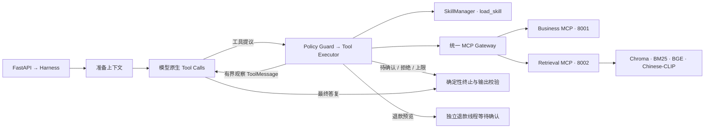

# 架构与边界

FastAPI 进程提供 REST、SSE 和 Agent Runtime。Business 与 Retrieval 分别通过独立的 FastMCP 进程部署，默认监听 loopback。SQLite 保存权威数据，LangGraph 将执行进度保存到独立的 SQLite checkpoint。

Harness 使用 ModelGateway、ContextManager、PolicyGuard、ToolExecutor 和 Telemetry 分别管理调用、上下文与权限。统一 MCP Gateway 管理两个连接，Business 保留业务授权和事务，TraceRecorder 负责持久化 Trace。Invocation、LangGraph checkpoint 和退款 workflow 各自保存执行、图进度和业务状态。

完整职责、生命周期与恢复限制见 [Harness 运行说明](harness_runtime.md)，旧模块复用清单见 [集成图](harness_integration_map.md)。原有工具/RAG/退款安全边界继续适用。

普通聊天运行原生 Tool-Calling Agent Loop；`deterministic` 仅替换模型响应，仍走同一 LangGraph、工具权限和状态机。API 和评测意图标签由已执行工具派生，不参与编排。Skill 只有元数据进入首轮模型，上下文需要正文时使用 `load_skill`；个性化推荐才在准备阶段检索记忆一次。

工具按返回顺序执行，结果与 `tool_call_id` 一一对应。默认上限为 8 次模型决策与 12 次工具执行，重复动作及不安全提议停止；待确认后本批剩余调用只记录跳过。`conv:` checkpoint 增加独立原生消息通道，不清空既有订单引用或 `wf:` 状态。

业务回复分三步：后端从已核验的工具结果生成编号事实，现有 Loop 的最后一轮模型用事实标签组织自然语言，服务端核对标签完整性和衔接语后填入真实事实。未知、重复或遗漏的标签以及未经核实的断言都会触发确定性回退，不增加模型调用。知识库单独回答保留原引用校验；复合回答可用知识事实标签插入带来源的证据。待确认退款仍由工作流直接输出预览。

每个会话使用 `conv:<id>` 线程，退款使用 `wf:<id>` 线程。主 Agent 调用 MCP `begin_refund_workflow`，Gateway 签名绑定当前会话与 Invocation。Business 在同一事务保存预览并关联 Invocation，API 将确认中断持久化到独立线程后返回预览。

确认接口校验身份、凭据和预览后恢复图。Commit 节点直接调用 `Business.submit()`，事务内重新检查业务资格并按原幂等键写入退款申请。Verify 节点独立调用 `Business.refund_outcome()`。确认、重复确认和核验均可在 MCP 服务离线时完成。Trace 区分 MCP 工具调用与 Workflow 内部提交，受理回执作为助手消息归档一次。

API token 是随机高熵值，仅保存 hash。Gateway 从 API 鉴权得到的 ExecutionContext 逐次生成短时 HMAC 签名，通过 MCP 请求 metadata 传递。两端校验各自的密钥、受众、有效期和工具调用范围，并从 SQLite 核验用户和租户。Business 的 `X-Internal-Auth` 入口也要求新格式的签名与工具范围。签名和主体字段独立于模型工具参数。退款提交只由已确认的 Workflow 调用。

Skill 发现只读取 frontmatter。按需读取正文并记录版本、内容 SHA256、估算 token 与耗时。只允许仓库四个注册目录，拒绝路径穿越及 symlink 逃逸。

RAG 写入显式 1024 维本地编码，Chroma 禁用默认 embedding function；中文 BM25 使用 jieba。RRF 去重后本地 CrossEncoder 排序。索引构建到新 collection 和 BM25 工件，再将治理记录与 knowledge_snapshots 中的 active 指针在同一 SQLite 事务提交。active.json 是便于查看的副本，检索不信任该文件；即使文件写完而 DB 提交失败，仍读旧的已提交快照。模型修订改变后要求重建，模型单例缓存也区分配置路径与 revision。

新建的检索 collection 配置 HNSW `sync_threshold=1`。知识快照批量写入，图文作业逐条写入。小索引的 HNSW 元数据随写入持久化，便于随后由独立 Retrieval 进程读取。旧 collection 保留原配置，正常重建会应用新值。

Trace 由共享 Recorder 保存到 JSONL 和 SQLite，包含路由、Skill、网关真实工具尝试/结果、检索证据、工作流终态和错误。异常、超时、取消也落库。JSONL 不可写时保留 SQLite 副本并标记 storage_errors，避免把已受理退款伪装为失败。评测 Trace 包含 run_id/case_id，结果来自真实事件而非运行器补记。凭据不进入 Trace，usage token 数不会被误删。会话历史是功能数据，保存消息正文。当前不接入可选 Langfuse。

## MCP 工具注册与检索调用

| 服务 | 白名单 |
| --- | --- |
| Business | `search_products`、`get_orders`、`get_order`、`track_shipment`、`check_refund_eligibility`、`begin_refund_workflow`、`create_ticket` |
| Retrieval | `search_knowledge`、`search_products_by_image`、`search_text_by_image`、`search_images_by_text`、`search_products_by_image_and_text` |

网关按本地工具注册表确定所属服务及读写类型，服务注册表登记端点、受众、启用状态、超时与重试配置。首次连接发出 MCP `list_tools`，逐一比对本地可信注册定义的输入和输出 Schema。缺少、额外、重名或异主工具以及 Schema 漂移均会拒绝该服务的目录。模型继续使用本地目录与原有可见性规则。每个服务拥有自己的 FastMCP Client、HTTP 会话和连接锁，由 API 生命周期关闭。

Agent 根据可信会话状态补全商品指代，并校验商品是当前图文候选，再经 PolicyGuard 和 ToolExecutor 调用 Gateway。独立图文 REST 接口也使用同一读工具执行器，其签名调用范围仅允许图文查询。检索端接收查询、候选商品 ID、可信范围和必要的图片 ID，使用共享 SQLite 检查会话、图片用户归属和租户归属，重新检查关联文档。RAG 和图文查询在向量召回后都回查 SQLite。上传图片路径由受控存储根据数据库记录解析。外部 VLM 仍须服务端启用及用户逐次授权。

ToolExecutor 对读请求的连接失败、暂时性异常和超时执行有限退避，最多重试 `TOOL_READ_MAX_RETRIES` 次，所有尝试计入同一个逻辑工具调用及 Invocation Deadline。参数、权限和目录契约错误直接返回。任一 MCP 服务的失联只影响该服务。在有其他已核验结果的混合请求中，答复保留这些结果并提示检索失败。检索端没有本地兜底调用路径。

Trace 依序记录 `loop.tool_proposed`、`policy.checked`、传输 `tool`、`retrieval.execution`、`tool.result_validated` 和 `loop.tool_observed`。Retrieval 返回签名调用对应的 Invocation、Operation、Tool Call ID 和尝试序号，以及候选数、结果数、模型 revision、快照与分阶段耗时。Gateway 核对关联标识，Agent 持久化诊断和引用。评测按 operation_id 归并传输重试。

## 存储与部署

| 资源 | 所有权与维护约束 |
| --- | --- |
| `SQLITE_URL` | 三个进程连接同一份本机 SQLite。API 管理会话、图片与记忆，Business 执行业务授权与事务，Retrieval 读取治理和资源元数据。避免用网络文件系统跨主机共享 SQLite WAL。 |
| `CHROMA_PATH` 和 `BM25_INDEX_PATH` | 在线仅由单个 Retrieval 进程访问。执行 `scripts.build_kb`、`scripts.import_product_images` 或 `scripts.rebuild_multimodal_index` 前停止该进程。管理员重建知识库接口在 Retrieval 进程内与检索串行执行。 |
| `MULTIMODAL_IMAGE_PATH` | API 和 Retrieval 指向同一目录，API 写入，Retrieval 读取。两端以同一套 SQLite 图片记录为准。 |
| `MEMORY_CHROMA_PATH` | API 自有目录。升级后新的 collection 会从 SQLite 重新排队投影，默认后台 worker 补齐。可先停 API 执行 `scripts.rebuild_memory_index`，使语义召回在重启时立即可用。 |

端点、端口和密钥可独立部署与配置。默认三个进程同机，API 和 Retrieval 使用一致的工作目录或绝对数据路径。BGE 权重文件可由不同进程共用，API 内的记忆与 Retrieval 各自加载进程内模型，语义记忆启用后需预留独立模型内存。Retrieval 在线采用单进程和一个同步工作槽，冷启动受工具超时限制，客户端超时后已开始的本地计算可能继续至结束。

`rag-real`、`agent-real` 评测及离线检索消融会直接打开评测配置所指的索引。使用线上检索目录做这些实验时，先停止对应的 Retrieval 进程。确定性评测使用独立 fixture。内部 MCP 连接直连配置端点。跨主机传输应使用 HTTPS 和受控内部网络。
