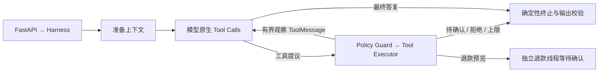

# 架构与边界

一个 FastAPI 进程提供 REST / SSE，一个 loopback FastMCP 进程提供七个真实工具。SQLite 是业务权威，LangGraph 的异步 SQLite saver 是执行进度，不是订单真相。

Agent Harness 增量层已接入：API → HarnessFacade/RunController → 原 LangGraph；节点使用注入的 ModelGateway、ToolExecutor、ContextManager、PolicyGuard 与 Telemetry。原 MCP Gateway 继续负责协议和 HMAC，原 Business 保留所有最终授权和事务，原 Recorder 是唯一 Trace 出口。Invocation 与图进度/业务 workflow 是三个不同状态。按图线程锁替代原全局锁，不同会话可并发；单 worker 限制明确保留。

完整职责、生命周期与恢复限制见 [Harness 运行说明](harness_runtime.md)，旧模块复用清单见 [集成图](harness_integration_map.md)。原有工具/RAG/退款安全边界继续适用。

普通聊天运行原生 Tool-Calling Agent Loop；`deterministic` 仅替换模型响应，仍走同一 LangGraph、工具权限和状态机。API 和评测意图标签由已执行工具派生，不参与编排。Skill 只有元数据进入首轮模型，上下文需要正文时使用 `load_skill`；个性化推荐才在准备阶段检索记忆一次。

工具按返回顺序执行，结果与 `tool_call_id` 一一对应。默认上限为 8 次模型决策与 12 次工具执行，重复动作及不安全提议停止；待确认后本批剩余调用只记录跳过。`conv:` checkpoint 增加独立原生消息通道，不清空既有订单引用或 `wf:` 状态。

业务回复分三步：后端从已核验的工具结果生成编号事实，现有 Loop 的最后一轮模型用事实标签组织自然语言，服务端核对标签完整性和衔接语后填入真实事实。未知、重复或遗漏的标签以及未经核实的断言都会触发确定性回退，不增加模型调用。知识库单独回答保留原引用校验；复合回答可用知识事实标签插入带来源的证据。待确认退款仍由工作流直接输出预览。

每个会话 thread 为 conv:<id>，退款 thread 为 wf:<id>。退款预览事务保存订单、金额、policy version、order version、nonce hash、稳定 operation key。等待节点 interrupt 不执行写入；confirm 先事务确认身份、有效期及预览，然后 Command(resume)；独立 commit 节点再次检查业务资格。退款记录与 workflow 终态在同一事务提交，唯一订单与幂等键防止并发重复退款。未知写入结果按原 operation key 查单，不创建新键重试。

提交工具返回后还须核对 SQLite 中同一 workflow 的实际受理回执，空口成功不能完成图。已受理的重复确认直接读原业务结果，不依赖 MCP 可用。受理回执作为助手消息归档一次；退款进度通过 get_order 返回的本人 refund_request 查询，不能把进度问题当成新申请。会话恢复最近消息、订单列表和商品指代，工单包含相关问题摘要。

API token 是随机高熵值，仅保存 hash。Gateway 逐次签名 actor context，通过 HTTP header 传输；工具 Schema 不含 actor 或密钥。MCP 校验 HMAC、aud、exp 和用户租户匹配，业务读取再次限定 tenant_id + user_id。退款提交不在模型白名单。Skill 正文不影响授权。

Skill 发现只读取 frontmatter。按需读取正文并记录版本、内容 SHA256、估算 token 与耗时。只允许仓库四个注册目录，拒绝路径穿越及 symlink 逃逸。

RAG 写入显式 1024 维本地编码，Chroma 禁用默认 embedding function；中文 BM25 使用 jieba。RRF 去重后本地 CrossEncoder 排序。索引构建到新 collection 和 BM25 工件，再将治理记录与 knowledge_snapshots 中的 active 指针在同一 SQLite 事务提交。active.json 是便于查看的副本，检索不信任该文件；即使文件写完而 DB 提交失败，仍读旧的已提交快照。模型修订改变后要求重建，模型单例缓存也区分配置路径与 revision。

Trace 由共享 Recorder 保存到 JSONL 和 SQLite，包含路由、Skill、网关真实工具尝试/结果、检索证据、工作流终态和错误。异常、超时、取消也落库。JSONL 不可写时保留 SQLite 副本并标记 storage_errors，避免把已受理退款伪装为失败。评测 Trace 包含 run_id/case_id，结果来自真实事件而非运行器补记。凭据不进入 Trace，usage token 数不会被误删。会话历史是功能数据，保存消息正文。当前不接入可选 Langfuse。
