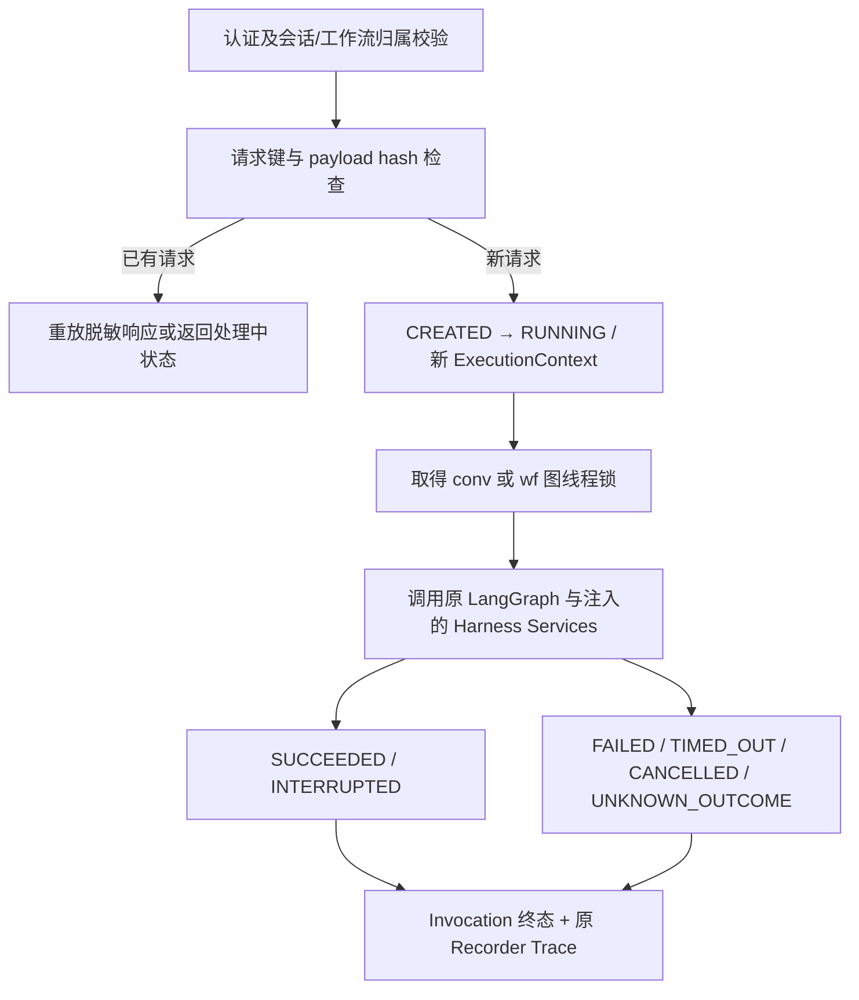

# Agent Harness Runtime

这是原客服 Agent 的运行控制层，复用原 StateGraph、Skill Manager、FastMCP、Business、RAG 与 Evaluation。详细对照见 [harness_integration_map.md](harness_integration_map.md)。默认启用；`HARNESS_ENABLED=false` 会暂停 Agent 执行并返回 CONFIG_ERROR，不提供绕过安全控制的旧执行路径。普通业务查询 API 仍由原认证与业务层处理。

## 一次调用的生命周期



一个 chat、stream 或 confirm 请求对应一个 invocation。Graph 进度仍由 AsyncSqliteSaver 保存到原 checkpoint 数据库。退款等待时 invocation 为 INTERRUPTED，业务 workflow 为 WAITING_CONFIRMATION；释放锁，不保持后台任务等待用户。确认创建新 invocation，以 parent_invocation_id 和同一个 wf thread 恢复原图。普通商品咨询仍执行 conv thread。

新增 Alembic `0003` 仅添加 agent_invocations 与 context_summaries 及其索引，不修改订单、退款规则、原 MCP 名字、知识索引或历史迁移。`python -m alembic upgrade head` 可升级原有数据库。DB.initialize 仍保留原本的本机初始化兼容行为。

## 可信身份与四种不同的键

API Auth 生成可信 Principal，Facade 校验归属并创建 frozen ExecutionContext；模型、历史摘要和 source 字符串都不能覆盖身份或图线程。Context 不含 API key、签名 token 或 MCP secret。调用节点显式接收 ctx/services；ContextVar 仅用于关联原 Recorder。

- invocation_id：服务端每次新执行的唯一 ID。
- client_request_id：现有 chat.request_id，以及新增可选 confirm.request_id；同租户/用户/会话唯一，body hash 不同返回 409 REQUEST_CONFLICT。
- MCP request_id：一次工具结果标识，operation_id + attempt_no 进一步关联传输尝试。
- workflow.operation_key：原后端稳定退款业务幂等键，不能用以上键替换。

重复的终态请求返回原持久化响应和 invocation_id，仍为 UNKNOWN_OUTCOME 的聊天写入可以继续只读核对原回执。正在运行的请求返回 processing=true 和可查询 ID。原响应是脱敏快照。**预览 nonce 明文只在首次响应交付**，重放的 pending_confirmation 带 confirmation_credential_available=false。客户端必须保留首次 nonce，丢失可取消原预览后重新申请。受理确认重放能返回原退款编号。

新增 `GET /api/v1/invocations/{invocation_id}` 仅供本人查询状态、预算和脱敏响应。错误响应仍保留原 envelope，在 error 中可附 invocation_id / trace_id。API 的缺 LLM 配置为 CONFIG_ERROR；旧 Python Agent.chat 兼容帮助方法保留 LLM_NOT_CONFIGURED 等旧错误别名，内部同样经过 Harness。

## 调用边界与恢复

模型请求只有 app/harness/model_gateway.py 一处 SDK create 调用。动作决策、知识回答和可选 Judge 共用它；Agent.llm 仅为缓存客户端工厂。底层 SDK max_retries=0。默认 JSON 指令加严格 Pydantic 校验，不假定所有兼容 API 支持原生 JSON 模式；有明确支持时可设 MODEL_JSON_MODE=true。

`complete_with_tools` 使用原生 SDK 响应，保留工具 ID 并返回匹配的 `ToolMessage`。服务端解析订单指代、检查参数和主体。`load_skill` 走 SkillManager。退款预览、RAG 和图文检索均经 ToolExecutor 和统一 MCP Gateway。直接提交退款只在确认后的 Workflow 内执行。HTTP 提供方明确拒绝工具协议时返回 `MODEL_TOOL_CALLING_UNSUPPORTED`。

| 情况 | 策略 |
|---|---|
| 模型 429、临时 5xx、连接错误 | 最多额外 2 次，指数退避加少量 jitter |
| 模型单次超时 | 最多额外 1 次 |
| 模型结构化输出非法 | 最多 1 次纠错；总调用次数另有硬上限和 Token/deadline 预算 |
| 模型 401/403、缺配置 | 不重试 |
| 读工具瞬态故障 | Harness 最多额外 2 次；原 Gateway 的内部重试在此路径关闭 |
| 工具业务 ok=false、参数/权限拒绝 | 保留业务原因，不按瞬态故障重试 |
| 退款写调用超时/断连 | 原 operation_key 读取 Business.refund_outcome；找到真实回执则返回原单，未知则 UNKNOWN_OUTCOME |
| 工单写结果未知 | 不盲重试，明确未知；客户端请求键保护重复入口 |

PolicyGuard 使用原 Skill Manager 可信白名单和严格工具参数 Schema。敏感退款只能经独立 execute_refund_from_workflow 能力路径；传 source='workflow' 无效。确认状态、订单/金额/版本及最终事务仍由原 Business 独立核验。成功工具数据也校验类型、订单/租户范围；退款必须能核对实际 DB 回执，不能仅相信工具自报成功。

每次 Loop 模型决策计一步，传输重试不增加该计数。LangGraph 在执行模型提议的下一项工具前同步写入检查点，包含原 invocation ID、批次游标、计数、已观察结果、动作签名和检索证据。处理重复提议、严重错误、待确认和预算上限时会结束剩余执行，并为被跳过的提议保留协议观察。`loop.*` 记录提议、策略结果、观察和终止；取消或超时会记录尚未观察的调用 ID。

每个组件使用 min(组件超时, remaining deadline)。读取消停止后续执行。工单发出前持久化 write_started，并用原 invocation ID 派生幂等工单号。退款预览在创建或复用时，在同一个 SQLite 事务中把 workflow_id 关联到 invocation。进程退出后，用同一 `request_id` 和原请求体显式重试，Harness 按当前用户和会话核对工单或退款预览，找到回执时返回原业务 ID 和 `recovered=true`。查不到回执的写请求返回 UNKNOWN_OUTCOME，后续同键重试可再次核对。对账只读业务库。普通会话检查点用于保留执行进度，任意中断处的模型推理续跑暂未提供。独立退款图仍由显式确认恢复，服务端先检查原确认凭据，再准备未写完的确认检查点。

## Context Manager

每次模型调用前重建上下文：系统规则、当前消息/可信 DB workflow、有效 Skill 正文及版本、带 chunk_id/version 的知识证据、近期消息、工具事实和摘要。模型 schema 加入后再次检查输入预算。默认窗口只是本机保护配置，实际部署需与供应商模型匹配。

当前本机使用官方 `deepseek-flash` API，配置模型窗口为 1,048,576、单次输入预算为 400,000、单个 Agent invocation 累计预算为 1,600,000。三个配置项分别为 `MODEL_CONTEXT_WINDOW`、`CONTEXT_MAX_INPUT_TOKENS` 和 `MODEL_MAX_TOKEN_BUDGET`。本地检查使用保守的 UTF-8 字节估算，实际用量取供应商 usage。修改配置后重启 API 进程生效。 [DeepSeek 模型元数据](https://api-docs.deepseek.com/api/list-models/)

采用保守 UTF-8 字节估算并保留输出/安全余量，标记 estimated，不能当作 tokenizer 精确计数或供应商费用。

- L0：去掉重复/冗长工具正文，保留请求引用、业务 ID、状态、错误和必要事实；超长事实进一步缩为业务引用。原工具证据仍在 Trace。
- L1：保留最近配置条数；原 messages 表不删除。当前图加载最近最多 200 条归档消息以限制装配内存，完整归档仍可经本人历史接口复核。
- L2：保存带来源范围、source_hash、版本和图线程归属的结构化事实摘要；当前实现为 verified_structured_facts_fallback，**没有声称生成 AI 语义摘要**。旧目标/细节通过消息 ID 引用保留，不编造“用户已经确认”。当前 workflow 每次重新读 DB，摘要不能改变它。业务状态或引用变化会生成新摘要，不覆盖旧记录。

超过阈值依次 L0→L1→L2；保留必要规则、状态和证据后仍超预算，返回 CONTEXT_BUDGET_EXCEEDED。三种策略 none / L0+L1 / L0+L1+L2 可以配置与对照；摘要并不保证保留所有历史细节。

## Trace 和 Evaluation

唯一持久出口仍是 app.observability.TraceRecorder 的 JSONL + SQLite。扩展 schema_version=1.1，所有事件关联 invocation、trace、评测 run/case、conversation、graph thread、span、ts 和 attributes。新增 model/context/tool/policy/workflow/recovery/invocation 事件；旧事件保留兼容。

工具 layer=transport 是真实网关尝试，layer=harness 是完成校验/恢复后的一个业务调用。Evaluation 统计工具集合、顺序及副作用时不把多次传输当成多笔业务；权限审计仍检查原始上游成功响应，不能让 Harness 拦截隐藏上游权限缺陷。模型失败尝试与最终 invocation 状态同样分开。

原 Evaluation CLI 额外输出 Invocation Success Rate、状态分布、Model Retry Rate/总 attempts、Tool Error Rate/attempts、Step Limit Hit Rate、estimated 压缩比、Unknown Outcome Count、违规提议/实际副作用及任务通过率。分子、分母或 NOT_AVAILABLE 明确列出。纯检索 CLI 无 Agent invocation 时相应指标为 NOT_AVAILABLE。比较报告追加 harness_deltas，新增安全失败仍硬阻断。

写入未决时，case 的 passed=null、evaluation_status=UNKNOWN_OUTCOME；退款完成断言暂不下结论。真实越权/重复写证据仍独立判错。未决 case 不算成功或失败退款，不可审核晋升为失败真值；mandatory 未决使门禁 BLOCKED，等待显式对账。报告和原失败列表单独区分这类 case。

模型请求只记用途、hash、usage/估算来源和错误类型，不保存 system prompt、原始提供商异常或密钥；工具敏感参数和手机/地址字段脱敏。TRACE_CONTENT_ENABLED 不会开启授权信息记录。Langfuse 未集成，不影响本地业务与评测；未宣称已测试第三方 SDK/服务端兼容性。

## 运行与验证

```powershell
.\.venv\Scripts\Activate.ps1
python -m alembic upgrade head
python -m scripts.harness_smoke
python -m scripts.context_experiment
python -m pytest -q tests/unit/harness tests/integration/harness
python -m pytest -q -m "not real"
python -m scripts.run_eval --dataset datasets/workflow.jsonl --mode deterministic --agent-release harness-v1
```

所有 Harness 强制测试和 smoke 无真实 LLM、无 Langfuse、无 BGE 权重也能运行；pytest 的额外 models 标记验证真实本地 BGE，real 标记才需要真实主 LLM。后续用户配置 DeepSeek 并授权后，已补跑真实 Agent 验收。Harness 原阶段结果见 IMPLEMENTATION_REPORT 的 Harness Completion，最新真实结果见同文件的 DeepSeek 真实验收。

本机锁、信号量和受控任务仅适用于 Uvicorn 单 worker；不是分布式锁、可靠任务队列或生产 SLA。数据库原退款唯一约束仍能独立防并发重复。不要用 HTTP timeout 推断业务失败，也不要把 Fake 的任务通过率当成真实客服智能效果。
